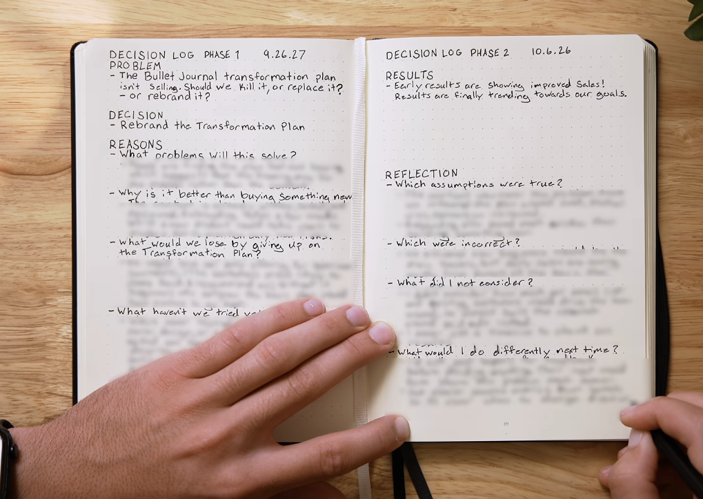
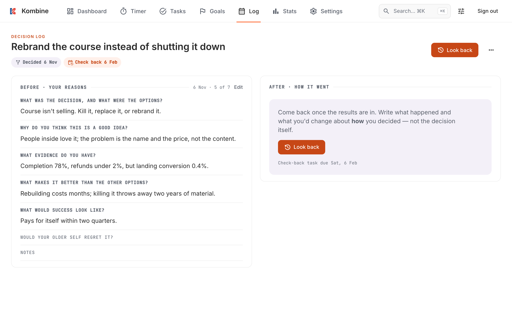
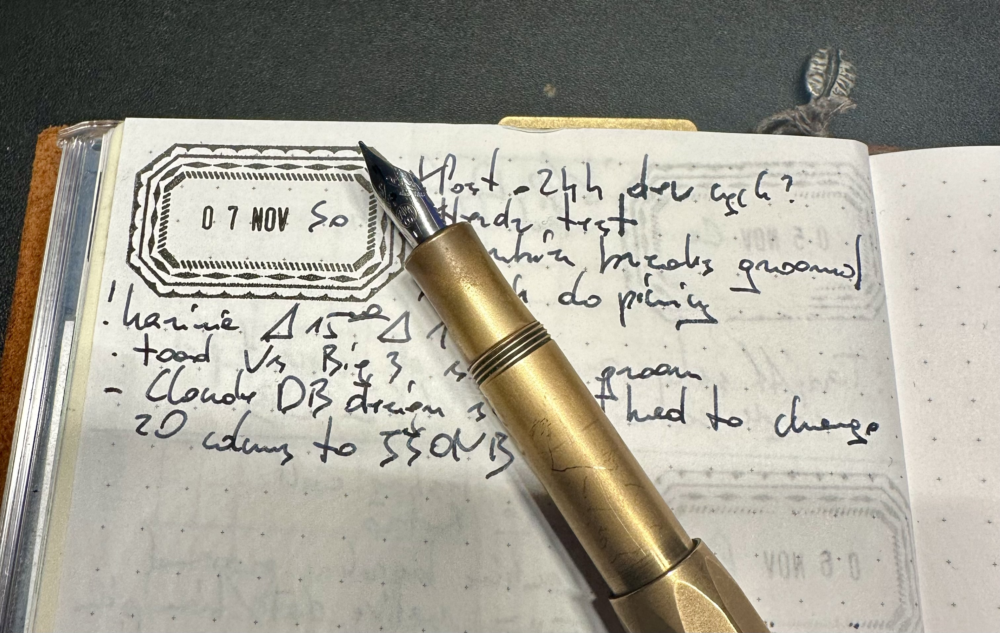

In March, I needed a swarm of agents to ship a feature. This time, I needed a coffee.

I like thinking on paper. I enjoy my German fountain pen marking the surface of my Japanese notebook. It forces me to slow down and think before I write; changing ink soaked into paper isn't an option. Paper gives flexibility; an empty page can be anything, organized in a million ways. There are very few constraints.

But for anything I want to find again, I use digital tools, and those are opinionated, structured, and full of constraints.

Using decades-old software engineering principles, I built a new feature in my app in just a few hours, inspired by a YouTube video. I set constraints so I could let the LLM run loose and focus on the product.

## The decision log

Recently I saw a [video of a Bullet Journal creator](https://youtu.be/dInecdJIKog?si=-bWJ4OxMKE2guVnP), showing a decision log. It reminds me a lot of the ADRs (Architecture Decision Records) I often use in the software I build. It has a structure, like:

- the problem statement - what is this decision helping with?
- the decision - one sentence
- reasons for this decision - bullet points with information, evidence, reasoning

The assumption is that you always make the best decision at the moment, with what you know at the time. It may not be objectively the best one; you will learn new information later, but the point is to record the state of the world when you make the decision. The reflection part comes later.

In the video, it's done on paper—5 sections in total, with some mid-section prompts to guide you.

I saw the video right after it was published, and I had only one thought: how hard would it be to include this as a feature in my productivity app? It is a rather simple static form, with a few questions and answers. A new DB table and reused existing UI components. I had no idea yet how it should look and feel, but this is what I'd use an LLM for: to help me figure it out.

In case my non-existent marketing didn't reach you, I am building an app called [Kombine](https://kombine.dev/). It started as a Pomodoro timer with nice sync between all your devices, including your smartwatch, but has gained some fat in the last few months.

## One coffee later

So I used the video transcript as input for Claude to work out how it could fit into my app. After an hour or so of a ping-pong match with prompts and responses, I had something. Something fitting nicely next to existing features.

Design was pretty fast; Claude Design just used my already established, aligned design system on all platforms: phone, tablet, and web.

Then it created concrete tickets for mobile, web app, and API repos. The tickets were brief and vague on purpose. My approach has also shifted over the past year: from comprehensive recipes generated by an LLM for another LLM to implement, to a brief set of goals and notes—no code examples, rarely even a file name. LLM can figure things out quite well, follow observed patterns, go through project docs (because you have project docs, right?), and doesn't require babysitting.

1 coffee later, I was testing it on the web app, and the mobile part was being built. It worked as expected, looked good, and even surprised me with a few nice UI touches I didn't explicitly plan during grooming.

## The boring stuff makes it possible

Why was it possible so fast?

It's not just LLMs. It's everything I build (with LLMs) around the project.

UI design was fast because Claude could use existing screens as references, pick typography and colors from the catalog, and reuse existing UI elements.

The implementation barely touched existing parts, so there was little risk of breaking anything. It also reused existing patterns and elements. There could be some duplication; Claude likes to do it, but it's not my concern now. I will run some static code analysis or Claude at some point for mechanical refactoring. Code is affordable to write and remove now.

All of this on top of existing tests, smoke runs, CI checks, etc. All the good practices that work with human teams.

## I don't need the swarm anymore

In just a few hours of work interrupted with diaper changes and feeding time, I went from inspiration to a working feature. And I didn't need a swarm of agents or a software factory for it. TBH I'm not even sure if I like the idea of building a thing to build a thing.

What blew my mind is remembering how much I had to build [back in March](/2026-03-25-toilet-to-prod-pipeline/) to get a similar result. I had an orchestrator agent, planning agent, coder agent, QA, reviewer, etc. Their context windows and capabilities were so limited at the time that I had to divide responsibilities between them. This still works now, and is probably still useful for big projects. But I don't need that anymore.

I use some grooming skills to question myself by checking existing docs and code, then planning GH issues and design.

This feature was a single ticket in mobile and 2 in the API/webapp repo. I used another skill I wrote to implement it end-to-end: create a branch, write code, run linters and tests, compile before creating a PR, then let CI do its job, and merge manually after skimming the code.

I did not read all 5k lines of new code. I didn't need to: it was purely additive, CI confirmed existing behavior didn't change, and the blast radius was one new screen. The worst case was the new feature not working properly—I can live with that.

## Where I still pay attention

> Review decisions, not keystrokes.

I want to be involved in every step, from product-level feature planning through design to reviewing the implementation plan. E.g., I changed the DB schema; I didn't like the idea of having 20 separate columns for answers, and went with JSONB since that data will always change as a whole and never be queried by field anyway.

I want to be involved where it matters, not verify typos in code - I have CI for this. With constraints like a design system and an already established app with navigation, screens, UI components, event handlers, etc., there is little to do wrong—very little room to do anything other than the obvious implementation.

I wanted to test it manually anyway. My goal was to verify how a paper-based decision log framework could be adopted into a digital environment. Building it took less time than a clickable mockup used to.

## You still need an engineer

The same engineering practices that make human-written code better work well with LLMs. However, you need an engineer to build the workflow—a good one. Knowing frameworks or programming languages matters less than understanding engineering principles: knowing what NOT to do, when to look closely, and when to let go.

What worked for this build:

- **Start from the outcome.** I wanted to know if a paper framework survives going digital, not to automate anything.
- **Give it something to copy.** The design system and existing screens did more for the UI than any prompt.
- **Let CI argue about the boring stuff.** Linters, tests, and compile checks catch typos, so my attention goes to the DB schema.
- **Make it draw.** I may miss something weird in the code, but when an LLM draws a Mermaid diagram, I spot it right away.

None of this is LLM-specific. It's just engineering.

I noted changing the Claude Code DB design on paper, though.

